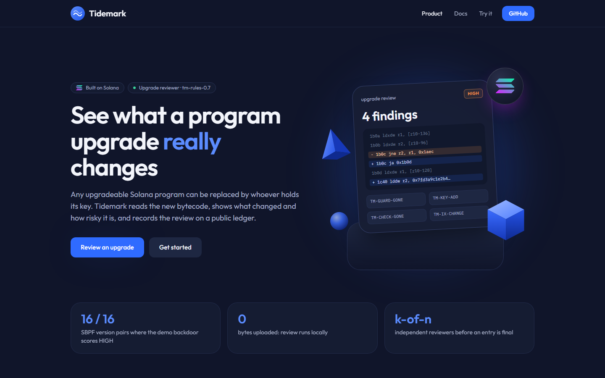
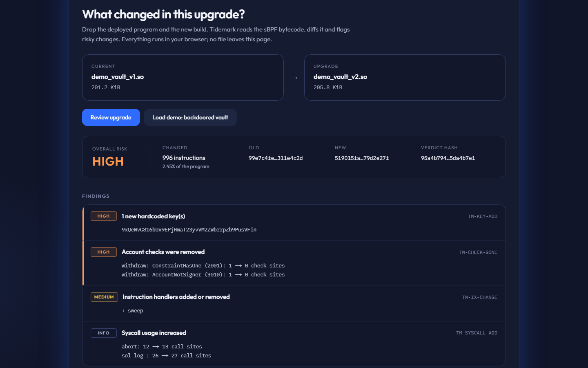
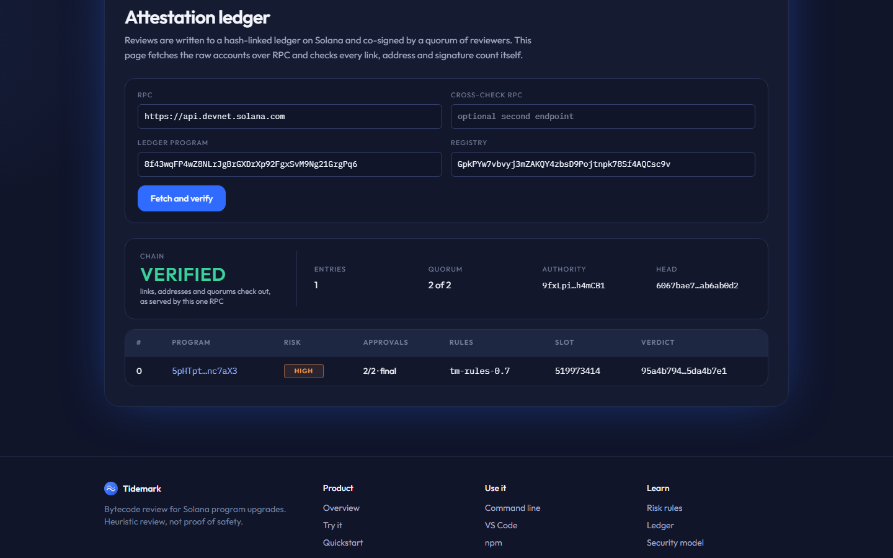
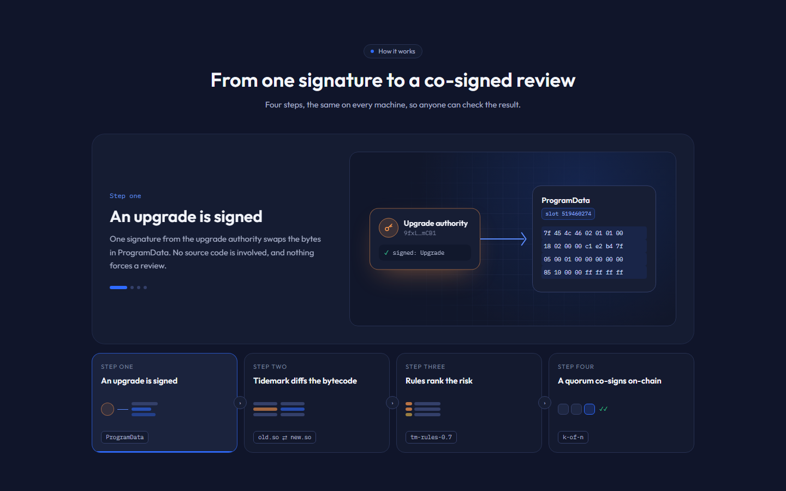
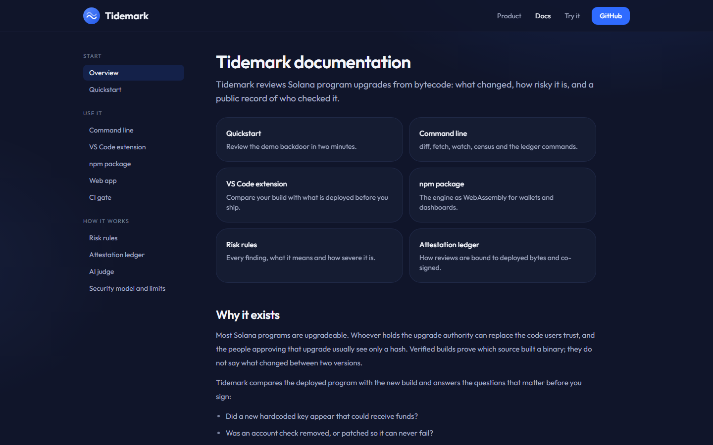

# Tidemark

[](https://github.com/IIITManjeet/Tidemark/actions/workflows/ci.yml)
[](https://github.com/IIITManjeet/Tidemark/releases/tag/v0.1.0)
[](https://www.npmjs.com/package/tidemark-wasm)
[](LICENSE)

**See what a Solana program upgrade actually changed, before and after it lands.**

[Live app](https://tidemark-sol.vercel.app) · [Demo video (2 min)](https://www.youtube.com/watch?v=0c6auYX0RL4) · [Docs](https://tidemark-sol.vercel.app/docs) · [Release v0.1.0](https://github.com/IIITManjeet/Tidemark/releases/tag/v0.1.0) · [npm](https://www.npmjs.com/package/tidemark-wasm) · [Ledger v3 on devnet](https://explorer.solana.com/address/8f43wqFP4wZ8NLrJgBrGXDrXp92FgxSvM9Ng21GrgPq6?cluster=devnet)

Built for the MLH Solana Hackathon.



Any upgradeable Solana program can be replaced at any moment by whoever holds
its upgrade authority. Users, integrators and even the multisig signers who
approve the upgrade usually can't see what the new bytecode does. Today's open
tooling monitors instructions, watches the authority header, or checks that a
build hash matches source. None of it shows the **behavioural difference
between two deployed versions**.

Tidemark reads the bytecode itself, tells you what changed and how risky it
is, and writes every review to a public, hash-linked ledger on Solana.

```
$ tidemark diff fixtures/demo_vault_v1.so fixtures/demo_vault_v2.so
Tidemark upgrade review  (tm-rules-0.7)
  old  99e7c4fe98f886be  20066 insns
  new  519015fa4879499f  20608 insns
  changed instructions: 996 (2.45%)
  overall risk: HIGH

[HIGH    ] TM-KEY-ADD  1 new hardcoded key(s)
             9xQeWvG816bUx9EPjHmaT23yvVM2ZWbrrpZb9PusVFin
[HIGH    ] TM-CHECK-GONE  Account checks were removed
             withdraw: ConstraintHasOne (2001): 1 → 0 check sites
             withdraw: AccountNotSigner (3010): 1 → 0 check sites
[MEDIUM  ] TM-IX-CHANGE  Instruction handlers added or removed
             + sweep
```

That is a real run against the demo vault and its backdoored upgrade, built
from `contracts/programs/demo-vault`. Tidemark recovers the attacker's address
byte for byte, spots that `withdraw` lost its `has_one` and signer checks and names the new `sweep`
handler, all from bytecode alone.

## Highlights

- **Reads what is deployed, not the source.** Decodes sBPF v0 to v3, aligns old
  and new builds so moved code doesn't hide the change, and flags new keys,
  removed signer and owner checks, new handlers, retargeted calls and new CPIs.
- **Same answer on every machine.** Deterministic, versioned rules produce one
  verdict hash. Tested on 67 mainnet programs: every self-diff clean, the CLI and
  the in-browser engine agree on 108 of 108 diffs.
- **Reviews live on Solana.** A quorum-signed Anchor ledger records each review.
  v3 hashes the deployed ELF on chain, refuses a mismatch and records the deploy
  slot. The ledger's own upgrade key sits behind a Squads multisig with a
  timelock.
- **Untrusted input stays contained.** `--isolate` runs the review in a
  separate process; on Linux it gets no filesystem and hard resource limits.
- **Wherever you work.** Web app (nothing leaves the browser), CLI and CI gate,
  npm package, VS Code extension, upgrade watcher and authority census.
- **AI that can only make you more careful.** An optional Gemini jury explains
  findings and must cite them; a majority can raise the risk, never lower it,
  and it never touches the verdict hash.

## Screenshots

| Review an upgrade | Verify the ledger |
|---|---|
|  |  |
| **How it works** | **Docs** |
|  |  |

## Get it

| | |
|---|---|
| Web app | https://tidemark-sol.vercel.app (runs in your browser; no install) |
| CLI | download for Linux, macOS or Windows from the [v0.1.0 release](https://github.com/IIITManjeet/Tidemark/releases/tag/v0.1.0), or `cargo install --git https://github.com/IIITManjeet/Tidemark tidemark-cli` |
| npm | `npm install tidemark-wasm` |
| VS Code | download `tidemark.vsix` from the [v0.1.0 release](https://github.com/IIITManjeet/Tidemark/releases/tag/v0.1.0), then Extensions → ⋯ → Install from VSIX… |

---

## Features

Status key: **Shipped** is in this repository and tested. **Roadmap** is designed
(see [HLD](docs/architecture/HLD.md)) but not built yet.

### 1. Bytecode-level upgrade diff · Shipped
Works on every deployable SBPF version, v0 to v3, with no source code or IDL
required. The version is read from the ELF header and each version is decoded
into one canonical form, so every rule runs unchanged: v2's moved memory
opcodes and `mov` + `hor64` constant pairs, v3's 32-bit jumps, static syscalls
and strict program-header layout (section headers may be absent). The demo
backdoor is caught as High in all 16 old→new version combinations. Once
SIMD-0500 activates, deploys, upgrades and freezing all require v3, so this is
what keeps Tidemark useful after the switch.
- A purpose-built **sBPF decoder** handles every instruction class, including
  two-word `lddw`.
- **Normalized comparison**: jump targets, internal call targets and load
  addresses are masked, so code that only *moved* compares equal. A second pass
  resolves the masked targets, so a branch or call that now points at different
  code is still reported, and a target that moved but runs the same code is not.
- **Bounded, deterministic work**: inputs over 16 MiB are rejected. The exact
  patience diff runs only when a work estimate computed from the inputs fits a
  fixed budget; otherwise a coarser diff runs and the report says so
  (`TM-PARTIAL`). The same inputs give the same report on any machine, and a
  hostile binary can't stall a CI job.
- **Syscall resolution** through `R_BPF_64_32` relocations (SBPFv1) and murmur3
  syscall ids (static syscalls). `call 0x…` shows as `call sol_invoke_signed_rust`.
- Extracts `.rodata` strings, candidate 32-byte keys and `security.txt` from both versions.

### 2. Upgrade risk rules · Shipped
Deterministic, versioned rules (`tm-rules-0.7`) turn a diff into ranked findings:

| Rule | What it catches |
|---|---|
| `TM-KEY-ADD` | New 32-byte keys, found anywhere in `.rodata` or rebuilt from four `lddw` immediates that are stored to, or compared against, consecutive 8-byte slots |
| `TM-CHECK-GONE` | An instruction handler lost Anchor account-check sites (`has_one`, signer, owner, seeds, address), counted by error-code immediates in the code each handler can reach |
| `TM-GUARD-GONE` | A conditional branch that leads into, or feeds, an error path was patched into an unconditional jump, retargeted to fall straight through, or deleted in a small edit, so the check still exists but can no longer fail |
| `TM-ERR-GONE` | An instruction handler lost custom error checks (`require!`, error codes 6000+) |
| `TM-IX-CHANGE` | Instruction handlers added or removed, read from the Anchor dispatch table; names confirmed by matching `sha256("global:<name>")[..8]` |
| `TM-SYSCALL-ADD` | New `invoke_signed` and other sensitive syscall call sites |
| `TM-CALLX-ADD` | New indirect calls with runtime-computed targets |
| `TM-BRANCH-RETARGET` | A branch that looks unchanged now jumps to different code |
| `TM-CALL-RETARGET` | A call that looks unchanged now calls a different function |
| `TM-TARGET-SWAP` | Branch or call targets that only trade places with each other: usually compiler reordering, reported as Medium |
| `TM-KEY-SPLIT` | Four or more new high-entropy 64-bit constants within a few hundred instructions: a key loaded in pieces that the stricter key rebuild did not match |
| `TM-CONST-CHANGE` | 64-bit constants (not addresses, not handler discriminators) that are no longer used |
| `TM-CONST-ADD` | New 64-bit constants (informational) |
| `TM-SECTXT` | `security.txt` removed or changed (possible change of responsible party) |
| `TM-CHURN` | Large rewrites that can hide small malicious changes |
| `TM-PARTIAL` | Analysis hit a time or size limit, so findings may be missing |
| `TM-VERSION-CHANGE` | The SBPF version changed, so the program was rebuilt for a new target; retargets, guards and rodata keys may be recompilation noise, but keep their severity because the version field alone is easy to change |

Well-known program ids (System, Token, Token-2022, ATA, …) are recognised and
named, so a new reference to Token isn't mistaken for a planted key.

These rules are heuristics over compiled code, tuned on Anchor programs. They
catch the demo backdoor exactly, but a determined attacker can shape code to
avoid them (for example splitting a key across functions, or reusing an
existing CPI call site). Treat a clean report as "nothing obvious
changed", not as proof of safety. Known gaps are tracked as GitHub issues.

### 3. Quorum-signed attestation ledger · Shipped (v2 and v3 live on devnet)
An Anchor program (`tidemark-ledger`) records reviews on Solana. v3
(`8f43wqFP4wZ8NLrJgBrGXDrXp92FgxSvM9Ng21GrgPq6`, built for SBPF v3) adds:
- **Deploy binding**: `attest` reads the reviewed program's ProgramData on
  chain, hashes the ELF itself and refuses unless it is the reviewed build; the
  deploy slot and ELF length go into the entry. `approve` refuses once the
  program has been redeployed.
- **Full-content approvals**: each approval signs a domain-separated digest of
  the entry hash, which covers program, both code hashes, risk, rules version
  and deploy slot, and `tidemark approve` verifies the whole chain first.
- **Rotation-safe registries**: the address comes from the first authority,
  stored as `seed_key`, so handing a registry to a new key keeps its address.
  A `config_version` counter records every reviewer, threshold or authority
  change, and late-added approvers are shown.

The full v3 flow (register, upgrade, attest, co-sign, rotate, verify, refuse
after a redeploy) has been run end to end on a local validator. On devnet,
registry `GpkPYw7vbvyj3mZAKQY4zbsD9Pojtnpk78Sf4AQCsc9v` holds the demo upgrade,
bound to its deploy slot and co-signed 2 of 2. Clients read v2 and v3.

In both versions, who may speak for a registry is enforced by the contract itself, not by trusting
whoever holds a key file.
- **Reviewer allowlist**: only keys the registry authority adds on-chain
  (a `Reviewer` PDA per key) can attest or approve. Anyone else is rejected by
  the program.
- **k-of-n quorum**: each entry records the threshold in force when it was
  created. Other reviewers co-sign with `approve`, one `Approval` PDA each, so
  nobody can vote twice. An entry is *final* once it reaches k approvals. The
  threshold can never exceed the number of active reviewers.
- **Independent re-review**: `attest` fetches the deployed program from chain
  and runs the diff itself; `approve` re-runs the whole review on the
  approver's machine and refuses to co-sign unless it reaches the same verdict.
  A quorum therefore means k reviewers got the same answer on their own.
- **Deterministic verdict hash**: what is attested covers the rules version,
  both code hashes, the findings and the risk, and leaves out timing-dependent
  parts of the report, so honest reviewers on different hardware agree.
- **Two-step authority rotation**: the authority proposes a successor, who
  must sign to accept. A typo can't hand a registry away, and a lost key can be
  replaced before it matters.
- **Sponsored fees**: a separate payer covers rent and fees, so reviewer keys
  never need to hold SOL.
- **Hash-linked entries**: `entry_hash = sha256(index ‖ registry ‖ program ‖
  code hashes ‖ verdict ‖ risk ‖ rules ‖ model ‖ reviewer ‖ slot ‖ prev_hash)`.
- **Checked verification**: `tidemark verify-ledger` checks account owners,
  re-derives the registry, entry and approval PDAs, confirms every signer is a
  listed reviewer, counts approvals, requires slots to increase, and
  cross-checks the chain head across every `--rpc` you pass.
- **Confirmed writes**: every transaction is polled until confirmed, and a
  failed one is reported as a failure.

Who controls the ledger itself: the devnet v2 and v3 ledgers' upgrade authority is a
Squads v4 vault (`GoEyAVg55y1u327W4x26zwbFoTQ3ChQEHzvQqrkBQCf2`, multisig
`8jGmTqcvXfp8taPTq6u5Tmorbu7pByKGDmy4eYU2xki9`): 2 of 3 members must approve an
upgrade, and it can only execute an hour after approval. On devnet all three
member keys are held by one maintainer, so this shows the mechanism rather than
real key separation. The plan in #15 is independent members, a longer timelock,
then freezing the program. `verify-ledger` prints the ledger's upgrade authority
and warns if it was redeployed after entries were written.

### 4. CI gate for safe code shipping · Shipped
`tidemark diff` (and `tidemark proposal`) exits with code `2` when the risk reaches the `--fail-on` level
(`high` by default), so a pipeline can block risky upgrades automatically. Use
`--fail-on medium` to also stop on a new instruction handler or indirect call.
An unknown level is a usage error (exit `1`), never a silent pass. This repo's own
CI runs clippy with warnings as errors, the test suite, a live review of the
demo upgrade, and the Kani proofs.

### 5. Typed, proof-checked Rust · Shipped
- **Kani model-checking harnesses**, run in CI on every pull request and push
  to `main`: each sBPF decoding step on any input up to 24 bytes, the ELF
  length computation on any input up to 160 bytes, the loader's store, compare
  and dispatch scans over any 6 instructions, all four ledger account parsers
  on any prefix of their account size (and they accept exactly the full-size
  accounts with the right discriminator), and the transaction length encoding
  for every `u16`. Rendering, the
  SBPF version check and the `.rodata` scan are checked by exhaustive or
  randomized tests instead, because string formatting and sets are too costly
  for the model checker. Full ELF parsing (goblin) and the rules are covered by
  tests, not proofs.
- **Fuzz-style regression tests** for the inputs reviewers used to stall or crash
  the tool: oversized log names, tens of thousands of stack constants, very
  large unrelated programs, and malformed hashes in a report.
- **Typed on-chain accounts**: Anchor `Account<T>` with PDA seeds and bumps
  validated by the framework, `InitSpace`-derived sizes, checked arithmetic on
  the attestation counter, and a bounded risk value.
- **No SDK lock-in**: the client builds and signs Solana transactions itself
  (legacy message format, PDA derivation with an off-curve check, Anchor
  sighashes), so the library stays small and auditable.

### 6. Chain fetch and authority inspection · Shipped
`tidemark fetch` reads a program through the BPF Upgradeable Loader, strips the
45-byte ProgramData header, and reports the upgrade authority and last deploy
slot. Immutable programs are identified as such.

### 7. AI judge · Shipped (CLI and web)
`tidemark diff old.so new.so --judge`, or the *AI judge* panel in the web app, adds an advisory AI review on top of the
deterministic report. It is off by default and needs `GEMINI_KEY` in the
environment (`GEMINI_MODEL` picks the model, default `gemini-2.5-flash`); with
no key it says so and carries on. In the web app you paste your own key; it
goes from the browser straight to Google and is not stored.
- **Explainer:** a short plain-English summary of what the upgrade changes,
  referring to findings by id.
- **Jury:** three fixed yes/no questions, each asked three times: can a single
  key move funds, was an authority or ownership check removed, is there a new
  path that withdraws funds or closes accounts. The vote count is printed per
  question.
- **Citations or it didn't happen:** every "yes" must cite a finding id or a
  hunk that is really in the report. A "yes" that cites nothing real is dropped
  and counted as dropped.

Guardrails:
- The jury can raise the risk (a cited majority "yes" lifts it to at least
  High, which also drives the exit code) but never lowers it.
- Nothing the jury says enters the verdict hash, the report hash or any
  attestation. With `--json`, the judgement goes to a separate
  `<name>.judge.json` and the report file is unchanged.
- Program-derived strings (handler names, log strings, security.txt, code
  lines) reach the model only inside one quoted JSON string marked as untrusted
  data; answers are schema-checked JSON.
- The judge sits behind a small `Backend` trait, so another yes/no model can be
  added as one file.

Still on the roadmap: a triage agent for ambiguous diffs, and a verifier that
writes a LiteSVM test to reproduce a finding.

### 8. Cost-efficient inference cascade · Partly shipped
Expensive work runs only when it has to:
1. **Content cache** (Shipped, `--cache DIR`) keyed by both code hashes and the
   rules version. Repeat reviews are free.
2. **Rule pre-check** settles most diffs locally, with no model call and minimal RPC lookups.
3. **Model calls** use a fixed prompt prefix (system prompt plus rule pack), so
   the inference server reuses its **KV cache** across requests. Self-hosted
   deployments can add KV-cache quantization (TurboQuant-style, about 3–4 bits
   per value) to cut memory further.

### 9. Upgrade watcher with snapshots · Shipped (websocket and polling)
`tidemark watch <program>` polls ProgramData and keeps every deployed version
under `snapshots/<program>/<deploy slot>.so`. When the deploy slot changes it
reviews the upgrade against the previous snapshot, prints the report and
writes `<old slot>-<new slot>.json`. With `--attest <ledger>` it also records
each review on the ledger, using the same path as `tidemark attest`.

```
$ tidemark watch 5pHTptDKd3fS6vnx82rHxSH1xURrYacDr17uJhnc7aX3
5pHTpt…: baseline snapshot at slot 519447118
5pHTpt…: upgraded, slot 519447118 -> 519503311
Tidemark upgrade review  (tm-rules-0.7) …
```

It also subscribes to the program's ProgramData account over a websocket
(derived from `--rpc`, or `--ws URL`; `--no-ws` turns it off) and checks as
soon as the account changes, so an upgrade is reviewed within seconds instead
of at the next poll. Polling keeps running underneath, and a dropped socket
reconnects with backoff. The watcher still needs to be running before an
upgrade to have the old version.

### 10. Multisig pre-approval review · Shipped (CLI, Squads v4)
`tidemark proposal --multisig <MS> --index <N>` reads a Squads v4 vault
transaction, finds each program upgrade in it, fetches the buffer it would
deploy and the live program, and prints the same review as `diff`, with the
same `--json` and `--fail-on`. A signer can see the change before approving.
Still on the roadmap: posting the report to signers automatically when a
proposal is created, and proposals that use address lookup tables.

### 11. Upgrade-authority census · Shipped (CLI)
`tidemark census <program ids…>` (or `--file`) classifies who can upgrade each
program and whether it embeds a `security.txt`:
- **immutable**: no upgrade authority, or not owned by the upgradeable loader
- **single key**: the authority is an ordinary ed25519 key
- **multisig / governance**: the authority account is owned by Squads v3/v4
  or SPL Governance
- **program-controlled (PDA)**: the authority is off the ed25519 curve, so no
  private key exists and only a program can sign. A Squads v4 vault is a plain
  system account, so it shows up this way unless you name its multisig with
  `--squads <MULTISIG>`: census derives that multisig's vaults and, when one is
  the authority and the multisig is owned by Squads v4, reads the multisig
  account and reports its threshold, voting members and timelock, e.g.
  **multisig (Squads v4, 2 of 3, 1h timelock)**.

```
$ tidemark census --rpc https://api.mainnet-beta.solana.com JUP6Lkb… whirLbM… MarBmsS…
JUP6LkbZbjS1jKKwapdHNy74zcZ3tLUZoi5QNyVTaV4   program-controlled (PDA)   no
whirLbMiicVdio4qvUfM5KAg6Ct8VwpYzGff3uctyCc   program-controlled (PDA)   no
MarBmsSgKXdrN1egZf5sqe1TMai9K1rChYNDJgjq7aD   program-controlled (PDA)   yes
```

```
$ tidemark census 8f43wqFP… BFZg7MYz… --squads 8jGmTqcvXfp8taPTq6u5Tmorbu7pByKGDmy4eYU2xki9
8f43wqFP4wZ8NLrJgBrGXDrXp92FgxSvM9Ng21GrgPq6  multisig (Squads v4, 2 of 3, 1h timelock)   no  GoEyAVg55y1u327W4x26zwbFoTQ3ChQEHzvQqrkBQCf2
BFZg7MYzVzz1YypfmF2B6p842CXx33SBFGmSGep2TLLc  multisig (Squads v4, 2 of 3, 1h timelock)   no  GoEyAVg55y1u327W4x26zwbFoTQ3ChQEHzvQqrkBQCf2
```

Verified-build status and a public dashboard are still on the roadmap.

### 12. MEV transparency layer · Shipped (scanner), ledger publishing on the roadmap
`tidemark sandwich --slot N --to M --rpc <mainnet RPC>` reads each block and
flags a swap by one fee payer, a same-direction swap by someone else on the same
pool, then the first fee payer swapping back, all in one slot. It prints each
detection with the three signatures and the front-runner's raw gain, then a
Merkle root over the detections so a list can be committed to later. Swaps are
read from token balance changes, with the fee payer's native SOL counted as
wrapped SOL and SOL amounts taken from the pool's side. Multi-hop routes and
attackers that split signers are missed, a market maker trading both sides of
retail flow can be flagged, and each victim is its own detection. Slots the
cluster skipped are listed; a block the node can't serve stops the scan rather
than leaving a gap in the root. On mainnet slot 466953008 it finds a real
sandwich: one attacker, three victims, about 1.72 SOL gained. Publishing the daily root to the ledger is
still on the roadmap.

### 13. Isolated analysis runner · Shipped (Linux limits), partly roadmap
`tidemark diff OLD NEW --isolate` reads both files, then reviews them in a
child process with an empty environment that gets the bytes on stdin and
returns the report on stdout, so signing keys and files never share a process
with untrusted input. The report, verdict hash and exit code are identical to a
normal run; a crash, a 120 s timeout or malformed output is an error, never a
pass. On Linux the child also denies itself all filesystem access with Landlock
and runs under rlimits (2 GiB memory, 60 s CPU, no file writes, no new
processes). On macOS and Windows only the separate process and the timeout
apply. Still on the roadmap: a seccomp syscall allowlist (network is not
blocked yet) and a distroless image.

### 14. Distribution: npm and VS Code · Shipped
- **npm package** (`npm/`, Shipped): `tidemark-core` compiled to WebAssembly.
  `review(old, new)` returns the same report and verdict hash as
  `tidemark diff --json`, `inspect(bytes)` lists syscalls and handlers, and
  `fetchLedger(rpc, ledger, registry)` pulls the ledger accounts over JSON-RPC
  and verifies the whole chain in the browser. CI builds the package and checks
  it against the CLI's demo report. Published as
  [`tidemark-wasm`](https://www.npmjs.com/package/tidemark-wasm).
- **VS Code extension** (`vscode/`, Shipped): *Tidemark: Review a build
  against the deployed program* fetches the program over RPC (setting
  `tidemark.rpc`) and reviews your local `.so` against it before you run
  `anchor deploy`; *Review two program binaries* compares any two files. The
  report goes to a Tidemark output channel, with a warning when risk reaches
  `tidemark.warnAt`. Install `tidemark.vsix` from the v0.1.0 release (the
  Marketplace listing is awaiting review), or build with `bash scripts/build-vscode.sh`.
- Showing findings inline in the editor is still on the roadmap.

### 15. Web app · Shipped (review, AI judge, ledger feed, census, docs)
`web/` is a Next.js app in TypeScript, styled with Tailwind, exported as a
static site; nothing runs on a server. It loads the same WASM build as the npm
package.
- **Review**: drop the current and the new `.so` (or load the demo vault).
  The WASM engine produces the same findings, hunks and verdict hash as the CLI.
  Files never leave the browser.
- **Ledger**: enter an RPC endpoint, ledger program and registry. The page
  pulls the raw accounts at `finalized` commitment and verifies the hash
  chain, PDAs, reviewer allowlist and quorum itself, then lists each
  attestation with its risk and approvals. A single RPC could serve a
  consistent but stale or fake chain, so the page says which view it trusted.
  Add a second RPC and it shows VERIFIED only if both agree on the head and
  every entry hash.
- Landing page and tools in one responsive page: navy surfaces, royal-blue
  accents, Outfit type and hand-drawn SVG illustrations. Colours, radii, glow
  and breakpoints are Tailwind theme tokens in `web/app/globals.css`.
  Severity is always written out as text as well as colour, and motion stops
  under `prefers-reduced-motion`.

Build it with `bash scripts/build-web.sh` (writes `web/out/`) and serve that
folder with any static server, e.g. `python -m http.server -d web/out`. Set
`BASE_PATH=/Tidemark` when hosting under a subpath such as GitHub Pages. For
development, run the build once and then `npm run dev` in `web/`.
- **Who can upgrade?**: enter program ids (and any Squads multisigs) and the
  page classifies each one's upgrade control in the browser, including the
  Squads threshold, voters and timelock, the same way `tidemark census` does.

---

## Live on devnet

### Ledger v3

Ledger v3 binds each review to the deployed bytes: the program hashes the
ProgramData ELF on chain at attest time and refuses a mismatch, and records
the deploy slot. The demo vault upgrade is attested and co-signed 2 of 2. The
ledger's own upgrade authority is a Squads v4 vault (2 of 3, one-hour timelock).

| What | Address |
|---|---|
| Ledger program (v3) | [`8f43wqFP4wZ8NLrJgBrGXDrXp92FgxSvM9Ng21GrgPq6`](https://explorer.solana.com/address/8f43wqFP4wZ8NLrJgBrGXDrXp92FgxSvM9Ng21GrgPq6?cluster=devnet) |
| Registry (2-of-2) | [`GpkPYw7vbvyj3mZAKQY4zbsD9Pojtnpk78Sf4AQCsc9v`](https://explorer.solana.com/address/GpkPYw7vbvyj3mZAKQY4zbsD9Pojtnpk78Sf4AQCsc9v?cluster=devnet) |
| Entry #0 | [`8MGCYxTkAtDaq9JqZf3s8EqBGD2YJufEnLS5qEaPYLF`](https://explorer.solana.com/address/8MGCYxTkAtDaq9JqZf3s8EqBGD2YJufEnLS5qEaPYLF?cluster=devnet) |
| Ledger upgrade multisig (Squads v4) | [`8jGmTqcvXfp8taPTq6u5Tmorbu7pByKGDmy4eYU2xki9`](https://explorer.solana.com/address/8jGmTqcvXfp8taPTq6u5Tmorbu7pByKGDmy4eYU2xki9?cluster=devnet) |

| Step | Transaction |
|---|---|
| Ledger v3 deployed | [`4zSi2xLc…`](https://explorer.solana.com/tx/4zSi2xLcM5SeXNzVH4iFM8LXJ4BYdXBYR5G7yCCV2SVPQennbCjm7YwKoa5CdnZ7z4ACV14wZhjBHRRne5q64AR9?cluster=devnet) |
| Registry created | [`mjjtarsA…`](https://explorer.solana.com/tx/mjjtarsAUrQ2swyu7cRN8QG9B6dZTTUj2HUESrkS4HF9LSSJocfc78qiLNyFUikHYpwLchGX7qomD3o8cyGE3aA?cluster=devnet) |
| Threshold set to 2 | [`eqhqKE4V…`](https://explorer.solana.com/tx/eqhqKE4V1xzzX3m5f7FNUCmNSkfjECXk4EcxmMMMM2T2UjGRKFppAtTNF3k4TCYStQ2rvbL6fEvmGXwFqDnu3wP?cluster=devnet) |
| Reviewer 1 attests, deployed bytes checked on chain | [`947PWasP…`](https://explorer.solana.com/tx/947PWasPrY9KbKzrYnF6RAVD4xSJGToYKv3BZqa5ApiJ9YHUdYhNXwGGBF5jazYyYBR5oJUMTunhm5kCfZrDr6E?cluster=devnet) |
| Reviewer 2 re-reviews and co-signs (2/2, final) | [`4JaBaScS…`](https://explorer.solana.com/tx/4JaBaScShJ6LUNYAtpiS72DzeTkD8qQrAwLR7W6dYFWxLjvGFpRf4a6BqYkFzthDmXCUTQWWV65YDC93rwCkXzDH?cluster=devnet) |

```sh
tidemark verify-ledger   --program 8f43wqFP4wZ8NLrJgBrGXDrXp92FgxSvM9Ng21GrgPq6   --registry GpkPYw7vbvyj3mZAKQY4zbsD9Pojtnpk78Sf4AQCsc9v
```

```
threshold  2 of 2 active reviewers
  #0   slot 519973414  risk 3  program 5pHT…7aX3  by 9fxL…mCB1  2/2 final  deployed@519447118
https://api.devnet.solana.com: chain OK, 1 entries, head 6067bae7f62960a2
```

### Ledger v2

The ledger v2 program runs on devnet, and a real upgrade has gone through the
full quorum flow: deploy a vault, snapshot it, upgrade it on-chain to the
backdoored build, have reviewer 1 attest, and have reviewer 2 independently
re-review and co-sign.

| What | Address |
|---|---|
| Ledger program (v2) | [`BFZg7MYzVzz1YypfmF2B6p842CXx33SBFGmSGep2TLLc`](https://explorer.solana.com/address/BFZg7MYzVzz1YypfmF2B6p842CXx33SBFGmSGep2TLLc?cluster=devnet) |
| Demo vault (upgraded to v2) | [`5pHTptDKd3fS6vnx82rHxSH1xURrYacDr17uJhnc7aX3`](https://explorer.solana.com/address/5pHTptDKd3fS6vnx82rHxSH1xURrYacDr17uJhnc7aX3?cluster=devnet) |
| Registry (2-of-2) | [`72HSqJR6Y2uiedNWVQxDDRXYr9LjB4cDUn3Me2AtenxU`](https://explorer.solana.com/address/72HSqJR6Y2uiedNWVQxDDRXYr9LjB4cDUn3Me2AtenxU?cluster=devnet) |
| Reviewer 1 | [`9fxLpiKzK1zeF42911g5ruKDdTuJFduJSEXcZHh4mCB1`](https://explorer.solana.com/address/9fxLpiKzK1zeF42911g5ruKDdTuJFduJSEXcZHh4mCB1?cluster=devnet) |
| Reviewer 2 | [`BWueozAMDiJxxvc96NC8tnfHRKxeyKhB39kS13nzq9Np`](https://explorer.solana.com/address/BWueozAMDiJxxvc96NC8tnfHRKxeyKhB39kS13nzq9Np?cluster=devnet) |
| Entry #0 | [`ak6XANj3vkFQz1EGsVHzc2CLC9vF8CbB9rbTB2SFaKd`](https://explorer.solana.com/address/ak6XANj3vkFQz1EGsVHzc2CLC9vF8CbB9rbTB2SFaKd?cluster=devnet) |

| Step | Transaction |
|---|---|
| Vault upgraded to backdoored v2 | [`4YxnJMQY…`](https://explorer.solana.com/tx/4YxnJMQYyRrNEPtQgrvLSfy4CGpK7zC7yUiHa6PzJJkcDvbBAkLmUgTCad1ipJ4Q2oThmeCHkZQTipXJALVCcRyA?cluster=devnet) |
| Ledger upgraded to v2 | [`2ERLV1b7…`](https://explorer.solana.com/tx/2ERLV1b7gxv7LooeZBWwVYEAt5zruehKugXzWTrTXEPJGEfNFR1UqBheXcW67qboXBqrKpRGkZkTHJx6uM6reYjt?cluster=devnet) |
| Registry created | [`5bwesoG5…`](https://explorer.solana.com/tx/5bwesoG5rLpfdV2PLN7RhaYebP5R52q1AEJ8pQjitcXCVUfYQp5S35hUGhniJbkY1HCNXaqWsjnChXQXCYiVwxAx?cluster=devnet) |
| Reviewers added | [`542j9ayK…`](https://explorer.solana.com/tx/542j9ayKKxDUriUzwgqEqhqXifRYFg89g6spcC3YPnyNG83YBe3M558vgzGwebYwNgsE59q9J5hkBwwRhtERE2Lq?cluster=devnet) [`5DWDvHh8…`](https://explorer.solana.com/tx/5DWDvHh8NRb9WjRYuXwvHRdpVVujUpHPRWAVfA9RLqX9bEQtUdpHNgUcqzUzT8KLX67BPgGZMtvb1WUvgicanNiB?cluster=devnet) |
| Threshold set to 2 | [`4Lir1M6v…`](https://explorer.solana.com/tx/4Lir1M6vkHrJzTAAjgwWcUtpwLhXaK7yhTJ3DgMBcz5k8tEfqcjJvSJjLtCuTNa5W1LUrZNz3D5Zw37FmMDdkLz1?cluster=devnet) |
| Reviewer 1 attests (1/2, pending) | [`3LEvQwNJ…`](https://explorer.solana.com/tx/3LEvQwNJ4CJDjX8AwpXeri3LtyRCm3GHTsfeQwXPdAPhSAcawx5Dkv58XSSg5QRCG9arHxmwZ4Nh1Chdz3SL8TZx?cluster=devnet) |
| Reviewer 2 re-reviews and approves (2/2, final) | [`6sJWSnwV…`](https://explorer.solana.com/tx/6sJWSnwV7vbjwPKYV36K2GsKyzKcyR3fsGd9j2Du32h3XwJnekd6qme3bLkRGH1ppezXkJYuNH22mB4DTFt6QM8?cluster=devnet) |

Both reviewers independently computed verdict `30204461…0d31` (risk High).
On the same registry, a key that isn't on the allowlist was refused by the
program, and a second approval from reviewer 2 was refused too.

```sh
cargo run -p tidemark-cli -- verify-ledger \
  --program BFZg7MYzVzz1YypfmF2B6p842CXx33SBFGmSGep2TLLc \
  --registry 72HSqJR6Y2uiedNWVQxDDRXYr9LjB4cDUn3Me2AtenxU
```

```
threshold  2 of 2 active reviewers
  #0   slot 519460795  risk 3  program 5pHT…7aX3  by 9fxL…mCB1  2/2 final
https://api.devnet.solana.com: chain OK, 1 entries, head a47556f807496f9a
```

The first ledger version's registry (`BEeLrro…`) and entry (`84BquZa…`) remain
on devnet as legacy records; v2 uses new account types and seeds and does not
read them.

## Repository layout

```
crates/tidemark-core     diff engine, rules, AI judge, ledger client and verifier (Rust)
crates/tidemark-cli      `tidemark` command-line tool
crates/tidemark-wasm     the engine compiled to WebAssembly
contracts/               Anchor workspace
  programs/tidemark-ledger   attestation ledger program
  programs/demo-vault        demo vault and its backdoored v2 upgrade (devnet only)
web/                     Next.js app and docs site (static export)
npm/                     tidemark-wasm package
vscode/                  VS Code extension
deploy/                  upgrade watcher container (Dockerfile, railway.json at the root)
fixtures/                built program binaries used by tests and CI
scripts/                 build helpers
docs/                    architecture (HLD, LLD), testing, releasing, screenshots
```

## Quick start

```sh
# review the demo upgrade (v1 → backdoored v2)
cargo run -p tidemark-cli -- diff fixtures/demo_vault_v1.so fixtures/demo_vault_v2.so --json report.json
cargo run -p tidemark-cli -- diff old.so new.so --cache .tidemark-cache   # reuse earlier reviews (trusted local folder)

# publish a review of a deployed upgrade (snapshot taken before the upgrade)
cargo run -p tidemark-cli -- init-registry --ledger <LEDGER> --threshold 1
cargo run -p tidemark-cli -- add-reviewer --ledger <LEDGER> <YOUR_KEY>
cargo run -p tidemark-cli -- attest --ledger <LEDGER> --program <PROGRAM> --old before.so

# anyone can verify the chain
cargo run -p tidemark-cli -- verify-ledger --program <LEDGER_PROGRAM_ID> --registry <REGISTRY>

# inspect any deployed program
cargo run -p tidemark-cli -- fetch <PROGRAM_ID> -o program.so
cargo run -p tidemark-cli -- census <PROGRAM_ID>...      # who can upgrade these programs?
cargo run -p tidemark-cli -- watch <PROGRAM_ID>          # review every upgrade as it lands
```

### Commands

| Command | Purpose |
|---|---|
| `diff OLD NEW` | Review an upgrade locally; `--json` writes the full report |
| `inspect FILE` | Summarize one binary |
| `fetch PROGRAM_ID` | Download deployed bytecode and show its upgrade authority |
| `init-registry --threshold K` | Create a registry you control |
| `add-reviewer KEY` / `set-reviewer KEY --active BOOL` | Manage who may attest |
| `set-threshold K` | Change how many approvals make an entry final |
| `propose-authority KEY` / `accept-authority` | Hand a registry to a new key in two steps |
| `attest --program ID --old SNAPSHOT` | Review the deployed upgrade and publish the verdict |
| `approve --registry R --index N --old SNAPSHOT` | Re-run a published review and co-sign if it matches |
| `verify-ledger --registry R [--rpc URL]...` | Check chain, reviewers, approvals and PDAs |
| `proposal --multisig MS --index N` | Review a pending Squads v4 upgrade proposal before approving |
| `census PROGRAM... [--squads MS]` | Who can upgrade each program, with Squads threshold and timelock |
| `watch PROGRAM [--ws URL]` | Review every upgrade as it lands (websocket plus polling) |
| `sandwich --slot N [--to M]` | Scan slots for sandwich attacks and print a Merkle root |

Chain commands take `--keypair` (the signer) and an optional `--payer`.

### Building and verifying

```sh
cargo test --workspace              # unit and integration tests
cargo kani -p tidemark-core         # model-check the proof harnesses (Linux/macOS)
bash scripts/build-fixtures.sh      # on-chain programs + demo fixtures (Solana CLI 2.1+, Anchor 0.31)
```

## Documentation

- The web app ships a documentation site (`/docs`): quickstart, CLI, VS Code,
  npm, CI gate, rules, ledger, AI judge, and the security model. Build it with
  `bash scripts/build-web.sh` and open `web/out/index.html` through any static
  server.
- [Testing on real programs](docs/TESTING.md): 67 mainnet programs, determinism and web/CLI parity
- [Releasing](docs/RELEASING.md): npm, VS Code Marketplace, Open VSX, Vercel and Railway
- [High-level design](docs/architecture/HLD.md)
- [Low-level design](docs/architecture/LLD.md)

## License

MIT
